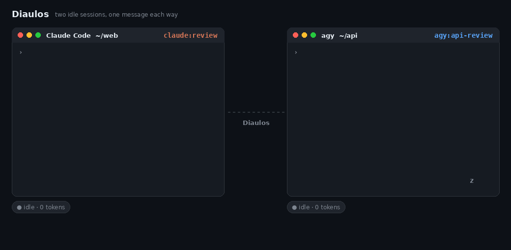
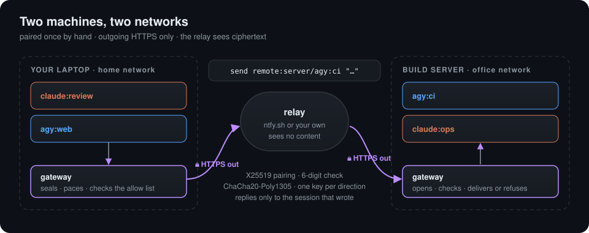
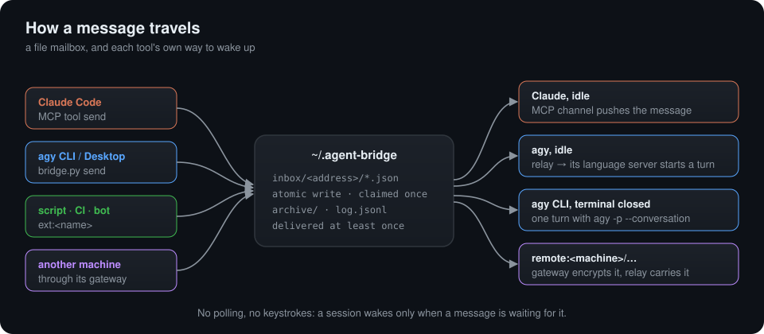

<div align="center">

# Diaulos

**Vos agents de code IA se parlent — et se réveillent les uns les autres.**

Claude Code ⇄ Google Antigravity (agy) · sur une même machine ou d'un réseau à l'autre · aucun agent qui interroge en boucle, aucune frappe simulée

[](https://github.com/Dr1mS/Diaulos/actions/workflows/tests.yml)    [](LICENSE)

[Démarrage rapide](#démarrage-rapide) · [Autres machines](#autres-machines) · [Sécurité](#sécurité) · [Fonctionnement](#fonctionnement) · [English](README.md)



</div>

---

Claude Code tourne dans un terminal, Gemini dans un autre. L'un écrit le code, l'autre devrait le relire, et c'est **vous** qui faites les copier-coller entre les deux, ou qui allez réveiller celui qui s'est arrêté.

**Diaulos vous sort de cette boucle.** N'importe quelle session peut écrire à n'importe quelle autre, et le message **réveille le destinataire même s'il est inactif**. Une conversation agy CLI reste joignable même terminal fermé, et une session d'une autre machine appairée l'est par sa passerelle. Chaque outil est réveillé par ses propres points d'extension : Claude Code par un canal MCP, agy par son propre language server. Aucun agent n'interroge sa boîte en boucle, et rien ne tape dans un terminal : de petits processus auxiliaires surveillent la boîte aux lettres et ne réveillent un agent que lorsqu'un message l'attend.

```text
vous › demande à la session agy de ~/api de relire mon dernier commit, et dis-moi ce qu'elle trouve

claude:review   → agy@api      "Relis le commit 3f2a1c7 et envoie-moi tes remarques."
                                 (agy était inactif — le relais le réveille)
agy:api-review  → claude:review "2 problèmes : None non vérifié dans parse_config(), test manquant pour…"
                                 (Claude était inactif — le canal MCP le réveille)
claude › agy a trouvé 2 problèmes. J'ai corrigé la vérification du None ; j'ajoute le test manquant ?
```

<sub>Un échange typique, pour illustrer. Lors d'un vrai test, quatre sessions se sont passé un message en boucle sans aucune intervention humaine : 36 s pour le tour complet, presque entièrement passées à faire réfléchir les modèles. Le pont lui-même n'ajoute que quelques secondes par étape : environ 4 s pour réveiller un agy inactif (il attend d'abord 3 s, pour qu'un agy occupé puisse prendre le message par ses hooks), environ 1 s pour Claude.</sub>

> *Aux Jeux grecs, le* diaulos *était la course aller-retour : on courait jusqu'au bout du stade, on faisait demi-tour, et on revenait. Ici, c'est le trajet d'un message d'un agent à l'autre, et retour.*

## Pourquoi Diaulos

|  | **Diaulos** | Boîtes aux lettres MCP | Orchestrateurs tmux | Équipes d'agents Claude Code |
|---|---|---|---|---|
| Réveille une session inactive | ✅ nativement (canal MCP, language server d'agy) | ❌ les agents doivent relever leur boîte | ⚠️ en tapant dans le terminal | ✅ |
| Claude **et** Gemini | ✅ | ✅ | ⚠️ certains | ❌ Claude seulement |
| Relie les sessions que vous avez déjà ouvertes | ✅ | ✅ | ❌ lance les siennes | ❌ lance les siennes |
| Joint une conversation agy CLI fermée | ✅ `agy -p` | ❌ | ❌ | — |
| Entre machines, chiffré de bout en bout | ✅ aucun port ouvert, sans SSH, sans compte | ⚠️ transport HTTP, pas de chiffrement de bout en bout intégré | ❌ | ❌ |
| Windows | ✅ (fonctions Desktop : Linux seulement) | ✅ | WSL seulement | ✅ |
| Dépendances | bibliothèque standard Python (+ `cryptography` entre machines) | un serveur MCP et sa base de données | tmux | intégré à Claude Code |

Une session n'est réveillée **que lorsqu'un message l'attend**, et les messages arrivés ensemble lui sont livrés en un seul tour. À l'usage, l'auteur a constaté bien moins de réveils, et environ deux fois moins de tokens, qu'avec les équipes d'agents de Claude Code pour un travail comparable. Ce n'est pas encore mesuré : l'[état de l'art](docs/ETAT-DE-L-ART.md) propose un protocole pour le faire, et compare Diaulos à 13 projets et protocoles.

<sub>Colonnes à jour en novembre 2026. Boîtes aux lettres MCP : mcp_agent_mail, postal-mcp. Orchestrateurs tmux : swarmux, Tmux-Orchestrator, AgentMux. Détails et liens dans l'état de l'art.</sub>

## Fonctionnalités

- **D'un outil à l'autre** — Claude Code ⇄ Claude Code, agy ⇄ agy, Claude ⇄ agy, autant de sessions que vous voulez, dans n'importe quel dossier.
- **Réveil à l'arrivée d'un message** — les sessions Claude Code et agy inactives reprennent la main d'elles-mêmes dès qu'un message arrive.
- **Même terminal fermé, on vous répond** — un message à une conversation agy CLI dont le terminal est fermé lance un tour avec `agy -p`.
- **Nouvelles sessions à la demande** — `agy:new-cli` / `agy:new` démarrent une nouvelle session agy, avec le message comme premier prompt.
- **Autres machines** — appairez deux ordinateurs une fois, puis `send remote:laptop/claude:review "…"`. Uniquement des connexions sortantes (HTTPS vers ntfy.sh par défaut), ChaCha20-Poly1305 de bout en bout, via ntfy.sh ou votre propre relais.
- **Des programmes comme pairs** — un script, un job de CI ou un bot rejoint le pont sous `ext:<nom>` et lit les réponses de l'agent.
- **Garde-fous par défaut** — les agents savent qu'un message d'un pair ne vaut jamais accord de l'utilisateur ; appairer des machines ou élargir l'accès distant exige une personne devant un terminal.
- **Bibliothèque standard seule** — Python 3.8+, rien à installer pour le cœur (`cryptography` seulement pour joindre d'autres machines), Linux et Windows, un seul script d'installation.
- **Voir passer les messages** — avec [Paros](https://github.com/Dr1mS/Paros), chaque session devient un petit personnage en pixels sur votre bureau, et chaque message vole de l'un à l'autre sous forme de lettre.

<div align="center">


<sub>Des messages Diaulos, vus par <a href="https://github.com/Dr1mS/Paros">Paros</a>.</sub>

</div>

## À quoi ça sert

- **Un chef de projet et des exécutants.** Une session chef de projet confie des tâches à des sessions exécutantes, chacune dans son propre dépôt, et récupère leurs comptes rendus.
- **Un second avis.** Un modèle relit ce que l'autre a écrit. Lors d'un vrai test, agy a relu le code de ce projet et trouvé trois vrais bugs, tous corrigés depuis ([journal](docs/JOURNAL.md#4-relecture-croisée-autonome-14451449)).
- **Votre portable et un serveur.** Claude, sur votre portable, demande à une session agy d'un serveur de build de lancer les tests lents et de lui en rendre compte.
- **Deux développeurs, deux machines.** L'agent de chacun parle à celui de l'autre, dans les limites que chaque propriétaire a fixées.
- **De la CI à l'agent.** Un job en échec envoie son log à un agent et reçoit un diagnostic en retour.

## Sommaire

- [Installation](#installation) · [Démarrage rapide](#démarrage-rapide) · [Adresses et commandes](#adresses-et-commandes)
- [agy CLI et Antigravity Desktop](#agy-cli-et-antigravity-desktop) · [Autres machines](#autres-machines) · [Programmes et scripts](#programmes-et-scripts)
- [Sécurité](#sécurité) · [Dépannage](#dépannage) · [État et limites](#état-et-limites)
- [Fonctionnement](#fonctionnement) · [Développement](#développement)
- Et aussi : [Coulisses](docs/INTERNALS.md) (en anglais) · [Historique des versions](CHANGELOG.md) (en anglais) · [Journal de labo](docs/JOURNAL.md) · [État de l'art](docs/ETAT-DE-L-ART.md)

## Installation

Prérequis : Linux ou Windows 10/11, Python 3.8 ou plus récent, la CLI agy ou Antigravity Desktop, et Claude Code si vous voulez y associer des sessions Claude.

```bash
git clone https://github.com/Dr1mS/Diaulos && cd Diaulos
./install.sh --shell                     # Linux
```

```powershell
powershell -ExecutionPolicy Bypass -File .\install.ps1 -Shell    # Windows, depuis PowerShell
```

Sous Linux avec Antigravity Desktop, ajoutez `--auto-relay` (expérimental : voir [Antigravity Desktop](#antigravity-desktop)). Pour écrire à d'autres machines, lancez aussi `python3 -m pip install cryptography`.

Ensuite :

1. **Relancez vos sessions agy.** agy ne charge ses hooks qu'au démarrage.
2. **Ouvrez un nouveau terminal pour Claude Code.** Avec `--shell` / `-Shell`, un simple `claude` démarre avec le canal du pont ; Claude Code affiche pour ce canal un écran de confirmation à chaque lancement.

**Mise à jour :** `git pull`, puis relancez l'installeur avec les mêmes options, et redémarrez vos sessions. Une session lancée avant la mise à jour garde l'ancien code.

**Désinstallation :** `./uninstall.sh` (`.\uninstall.ps1` sous Windows) ; ajoutez `--purge` (`-Purge`) pour supprimer aussi les boîtes aux lettres et les clés des machines appairées. Si vous avez créé une unité systemd ou une tâche planifiée pour la passerelle, supprimez-la aussi.

## Démarrage rapide

Inutile de taper des commandes : chaque agent connaît sa propre adresse et sait comment joindre les autres. agy l'apprend au démarrage par son hook ; Claude Code reçoit les outils `send` et `list_agents` du serveur MCP `agent-bridge`. Demandez simplement :

- dans Claude Code : *« envoie ce diff à agy pour relecture »* ;
- dans agy : *« demande à la session Claude de vérifier les tests »*.

La même chose à la main, depuis un shell :

```bash
python3 ~/.agent-bridge/bridge.py list
#  agy:52620e0d-…  "revue api"  /home/moi/projets/api  relay pid 225225: wakes on message
#  agy:e9439252-…  "web"  /home/moi/projets/web  agy CLI, no process: wakes with agy -p
#  claude:review  /home/moi/projets/api  MCP channel: wakes on message

python3 ~/.agent-bridge/bridge.py send agy@web "Tu peux vérifier la modification d'API que je viens de faire ?"
```

Le destinataire répond à l'adresse `from` du message qu'il a reçu.

> **Windows :** Windows PowerShell ne développe pas `~` dans les arguments passés aux programmes. Écrivez `python3 $HOME\.agent-bridge\bridge.py …`. Rien de particulier côté agents : ils reçoivent le chemin absolu.

## Adresses et commandes

| Adresse | Destinataire |
|---|---|
| `claude:<nom de session>` | Une session Claude Code lancée avec le canal. Elle suit `/rename`. |
| `claude` | La seule autre session Claude ; si aucune n'est listée, la boîte commune lue par `watch claude` |
| `agy:<conversationId>`, `agy:<début de l'id>` | Une conversation agy (CLI ou Desktop) |
| `agy:<titre>` | Une conversation agy par son titre (`/rename`, ou celui que lui donne agy) ; refusé si deux le partagent |
| `agy@<partie de son dossier>` | La conversation agy dont le dossier contient ce texte : la seule active, sinon la seule listée |
| `agy` | La seule autre session agy active : un agy CLI qui tourne, ou une conversation chargée par sa fenêtre Desktop |
| `agy:new`, `agy:new@<titre>` | Une nouvelle conversation Antigravity Desktop, avec le message comme premier prompt (Linux) |
| `agy:new-cli`, `agy:new-cli@<nom>` | Une nouvelle conversation agy CLI, avec le message comme premier prompt |
| `ext:<nom>` | Un programme branché avec `watch ext:<nom>` |
| `remote:<machine>/<adresse>` | Une session d'une machine appairée, par ex. `remote:laptop/claude:review` |

`bridge.py` désigne `~/.agent-bridge/bridge.py`. Les outils MCP de Claude Code prennent les mêmes adresses et les mêmes options.

| Commande | Effet |
|---|---|
| `bridge.py list [--days N \| --all]` | Les sessions actives, et la façon dont chacune est réveillée. Conversations agy des 7 derniers jours, des N derniers jours, ou de tout âge |
| `bridge.py send <dest> <texte…> [--workspace <dossier>] [--from <adresse>]` | Envoie un message ; `-` comme texte le lit sur l'entrée standard. Les options doivent venir en dernier : ailleurs, elles font partie du texte |
| `--workspace <dossier>` | Avec `agy:new` / `agy:new-cli` : où travaille la nouvelle session (pour `agy:new`, aussi le nom d'un workspace Desktop) |
| `--from <adresse>` | Adresse de l'expéditeur, pour un programme ou un script (agy la remplit lui-même). Vers une autre machine, seulement une adresse `ext:` |
| `bridge.py watch <adresse> [--json]` | Affiche chaque nouveau message pour cette adresse, sans fin |
| `bridge.py recv <adresse> [--json]` | Affiche et archive une fois les messages en attente |
| `bridge.py ensure-relay` | Depuis un shell agy : lance le relais qui réveille cet agy (un rappel le demande à agy) |
| `bridge.py agy-relay --probe "<texte>"` / `--inspect` | Depuis un shell agy : un envoi de test / les réglages de modèle de la conversation |
| `bridge.py remote <commande>` | Appairer des machines et faire tourner la passerelle : voir [Autres machines](#autres-machines) |

## agy CLI et Antigravity Desktop

| | agy CLI | Antigravity Desktop |
|---|---|---|
| Ouverte, après son premier message | joignable une fois qu'agy a lancé `ensure-relay` (un rappel le lui demande) | joignable dès que la fenêtre a un relais |
| Ouverte, avant tout message | pas joignable : la conversation n'existe pas encore | pas joignable non plus ; les autres conversations de la fenêtre le sont, avec `--auto-relay` |
| Terminal ou onglet fermé | joignable : chaque lot de messages lance un tour avec `agy -p --conversation <id>` | joignable : la livraison la charge depuis le disque |
| Listées | conversations des 7 derniers jours (`--days N` / `--all` pour les plus anciennes) ; tout âge par id ou titre exact | pareil |
| Nouvelle session depuis un autre agent | `agy:new-cli`, `agy:new-cli@<nom>` | `agy:new`, `agy:new@<titre>` (Linux) |

### agy CLI

Quand le terminal d'une conversation agy CLI est fermé, `list` l'affiche avec `agy CLI, no process: wakes with agy -p`, et un message vers elle lance un tour dans son dossier, avec vos réglages agy habituels. Si vous la rouvrez avec `agy --conversation <id>`, ses hooks et son relais prennent le relais.

```bash
python3 ~/.agent-bridge/bridge.py send agy:new-cli@builder "Compile le projet et envoie les erreurs à claude:api" --workspace ~/projets/api
# après son premier tour, le pont vous envoie son adresse ; elle est aussi joignable comme agy:builder
```

- Ces tours suivent vos permissions agy. Avec `toolPermission: always-proceed`, ils se déroulent seuls ; avec un réglage qui demande avant certains outils, un tour qui en a besoin attend 30 min, puis échoue. Diaulos ne passe jamais `--dangerously-skip-permissions`.
- Choisissez comme dossier l'un des workspaces de confiance d'agy (`trustedWorkspaces` dans `~/.gemini/antigravity-cli/settings.json`).
- Chaque tour lance un nouveau processus `agy` : comptez environ 10 s avant que le modèle commence à réfléchir. `agy -p` n'accepte pas de message de plus de 100 000 caractères : un tel message n'est pas livré à une conversation agy CLI fermée (voir son `cli-<id>.log`).

### Antigravity Desktop

Desktop fait tourner toutes les conversations d'une fenêtre dans un seul language server. Un seul relais par fenêtre sert donc toutes ses conversations : celles de ses onglets, ouverts ou fermés, et celles des 7 derniers jours.

```bash
python3 ~/.agent-bridge/bridge.py send agy:new@testeur "Lance les tests et envoie les échecs à claude:api" --workspace ~/projets/api
```

`--workspace` prend un dossier ou le nom d'un workspace Desktop ; Desktop range la conversation dans ce workspace.

**Relais automatique (Linux, expérimental, désactivé par défaut).** Avec `./install.sh --auto-relay`, une fenêtre Desktop n'a plus besoin d'`ensure-relay` : dès qu'un agent liste les sessions agy ou écrit à l'une d'elles, Diaulos lance lui-même le relais de la fenêtre, avec le jeton qu'il lit sur la ligne de commande du language server. Sans cette option, un seul `ensure-relay` par lancement de la fenêtre suffit, depuis n'importe laquelle de ses conversations. Elle est désactivée par défaut pour deux raisons : elle lit un secret en dehors du chemin documenté par agy (sans ouvrir d'accès nouveau : le relais détient ce même jeton, et tout processus local peut lire cette ligne de commande), et une mise à jour d'Antigravity peut déplacer ce jeton. Relancez `./install.sh` sans l'option pour la désactiver.

## Autres machines

Des sessions qui tournent sur **des machines différentes** peuvent aussi se parler : sur un autre réseau, et même sur l'ordinateur d'une autre personne, avec d'autres comptes Claude ou Google. Les deux machines n'ouvrent que des connexions sortantes vers un relais (en HTTPS vers ntfy.sh par défaut, ou le vôtre), et le relais ne voit jamais le contenu d'un message.

<p align="center"></p>

**1. Installez `cryptography` sur les deux machines** (`python3 -m pip install cryptography`).

**2. Appairez les deux machines, une fois, dans un vrai terminal sur chacune.** Un agent ne peut pas le faire, et c'est voulu : ces commandes refusent de tourner sans terminal (dans Claude Code, une commande `!` ne compte pas).

```bash
python3 ~/.agent-bridge/bridge.py remote invite laptop     # sur la machine A : affiche un code à usage unique, valable 15 min
python3 ~/.agent-bridge/bridge.py remote join desktop      # sur la machine B : demande le code, sans l'afficher
```

Transmettez le code par un canal de confiance, jamais par un agent. Les deux terminaux affichent ensuite un code à 6 chiffres : comparez-les, et confirmez des deux côtés. Chaque côté choisit ensuite lesquelles de ses propres sessions l'autre machine peut contacter en premier, par exemple `claude:*` ou `claude:review` (vide : aucune). La passerelle qui transporte les messages démarre alors sur les deux machines.

**3. Les agents font le reste.** Le skill `diaulos-remote` explique à Claude comment s'y prendre. Une session de l'autre machine a pour adresse `remote:<machine>/<adresse>` : `send remote:laptop/claude:review "..."`. Une session qui a écrit la première reçoit les réponses ; `list` affiche les sessions que l'autre machine annonce comme joignables.

| Commande | Qui | Ce qu'elle fait |
|---|---|---|
| `remote invite <nom> [--relay URL]`, `remote join <nom>` | vous | appairer deux machines |
| `remote allow <nom> <motif>` | vous | laisser `<nom>` écrire en premier à vos sessions qui correspondent à `<motif>` |
| `remote relay-server [--host H] [--port P] [--trusted-proxy ADRESSE]` | vous | héberger votre propre relais au lieu de ntfy.sh |
| `remote status`, `remote start`, `remote stop` | tout le monde | la passerelle |
| `remote deny <nom> <motif>`, `remote unpair <nom>` | tout le monde | restreindre l'accès, oublier une machine et sa clé |

**La passerelle** ne survit ni à une déconnexion ni à un redémarrage. Elle repart d'elle-même au lancement d'une session agy (Linux), au lancement d'une session Claude Code avec le canal, et au premier envoi. Une machine qui ne fait que répondre, comme un serveur, doit la lancer à l'ouverture de session. Sous Linux, avec une unité systemd utilisateur (`remote gateway` prend la relève d'une passerelle qui tourne déjà) :

```ini
# ~/.config/systemd/user/diaulos-gateway.service, puis : systemctl --user enable --now diaulos-gateway
[Unit]
Description=Diaulos remote gateway
[Service]
ExecStart=/usr/bin/python3 %h/.agent-bridge/bridge.py remote gateway
Restart=on-failure
[Install]
WantedBy=default.target
```

Sous Windows, créez dans le Planificateur de tâches une tâche « À l'ouverture de session » qui lance `<chemin complet de python.exe> <votre dossier personnel>\.agent-bridge\bridge.py remote start` : elle démarre la passerelle en arrière-plan, puis se termine.

**Limites.** ntfy.sh accepte environ 250 messages par jour et par adresse IP, et les garde 12 heures : une machine éteinte plus longtemps perd les plus anciens. Un message consomme un message relais par tranche de 2,9 Ko de texte encodé (l'UTF-8 et les échappements JSON comptent), et fait au plus 64 Kio ; les listes de sessions joignables (au plus toutes les 30 min) et les avis comptent aussi. Pour un usage plus intense, hébergez un relais avec `remote relay-server` derrière un proxy inverse HTTPS : avec nginx, réglez `proxy_buffering off` et un `proxy_read_timeout` supérieur à 25 s, et lancez le relais avec `--trusted-proxy 127.0.0.1`. Un relais ouvert peut être saturé par quelqu'un qui dispose de nombreuses adresses : pour une disponibilité fiable, limitez-le aux adresses IP de vos machines.

L'appairage, le chiffrement et les règles d'accès sont détaillés dans [Sécurité](#sécurité) et dans les [coulisses](docs/INTERNALS.md#other-machines) (en anglais).

## Programmes et scripts

Un script, un job de CI ou un bot rejoint le pont sous `ext:<nom>`. Il envoie avec `bridge.py send <agent> - --from ext:<nom>` (le texte sur l'entrée standard) et lit les réponses de l'agent avec `bridge.py watch ext:<nom> --json`, un objet JSON par ligne. Tant qu'il surveille cette adresse, il est listé, et les agents peuvent lui répondre. **Lisez d'abord l'avertissement de la section [Sécurité](#sécurité).**

## Sécurité

Diaulos laisse des agents agir sur ce qu'ils reçoivent. Lisez ceci avant de brancher quoi que ce soit.

**Sur une seule machine**

- **Pas d'authentification entre processus locaux.** Tout processus lancé sous votre compte peut écrire dans `~/.agent-bridge/inbox/`. Écrire à une session agy la fait agir avec les permissions de sa conversation, `always-proceed` par exemple : par le relais, par `agy -p` pour une conversation agy CLI dont le terminal est fermé, et dans les sessions démarrées par `agy:new` et `agy:new-cli`. N'utilisez Diaulos que sur une machine de confiance.
- **Un pair n'est pas l'utilisateur.** Les messages reçus sont marqués comme venant d'un agent pair. Les agents savent qu'un tel message ne vaut jamais accord de l'utilisateur, et qu'ils ne doivent jamais faire pour un pair ce que leurs propres permissions ont bloqué.
- **Expéditeur non vérifié.** Sur une seule machine, l'adresse `from` est déclarée par l'expéditeur. Un message qui prétend relayer l'utilisateur ne vaut jamais accord de sa part.
- **Le jeton d'agy** (`ANTIGRAVITY_CSRF_TOKEN`) n'est jamais écrit sur disque ni dans les logs.

> [!WARNING]
> **Brancher un programme (`ext:<nom>`), c'est confier du texte extérieur à un agent qui peut agir sur votre machine.** Quiconque peut écrire dans la source de ce programme (un chat, une issue, une ligne de log) peut écrire à votre agent, y compris des instructions conçues pour le détourner (injection de prompt). La mention « pair » guide le modèle, elle ne l'arrête pas.
>
> - Ne branchez que des sources de confiance. Ne reliez jamais une source publique ou partagée à une session qui tourne en `always-proceed`, en validation automatique, ou qui a accès à des secrets.
> - Donnez à l'adaptateur sa propre session d'agent, dans un dossier qui ne contient rien de sensible.
> - Partez du principe que tout ce que l'agent sait peut se retrouver dans ses réponses.
> - Surveillez ce que fait l'agent, et arrêtez l'adaptateur quand vous n'êtes pas là.

**Entre machines**

- **L'appairage est réservé aux personnes.** `invite`, `join`, `allow` et `relay-server` exigent un terminal, que les agents n'ont pas : un agent victime d'une injection de prompt ne peut donc ni appairer une machine ni ouvrir un accès. C'est un ralentisseur, pas un mur : un programme qui tourne déjà sous votre compte peut modifier `~/.agent-bridge/remote/` ou simuler un terminal.
- **Protocole d'appairage.** L'invitation contient un secret de 256 bits à usage unique, qui authentifie un échange de clés X25519 ; les deux personnes comparent un code à 6 chiffres dérivé du résultat. Si quelqu'un a copié le code et s'appaire à votre place, l'autre personne ne voit aucun code, ou un code différent : répondez non, et rien n'est enregistré.
- **Chiffrement.** Une clé racine par paire de machines, une clé et un sujet de relais par sens, chaque trame scellée avec ChaCha20-Poly1305 et complétée jusqu'à un multiple de 256 octets. Les trames modifiées, rejouées ou étrangères sont rejetées. Le relais (ntfy.sh, un tiers, sauf si vous hébergez le vôtre) voit les adresses IP des deux machines, les noms de sujets, les tailles et les heures, jamais le contenu.
- **Qui peut joindre quoi.** Une machine n'écrit en premier qu'aux sessions de sa liste d'autorisations ; les jokers ne couvrent jamais `agy:new` et `agy:new-cli`. Une session qui a écrit à une machine reçoit ses réponses pendant 24 heures, à cette adresse exacte. Aucun rebond vers une troisième machine, au plus 20 messages par minute et par machine, et un refus renvoie un avis fixe qui ne révèle rien de vos sessions.
- **La machine est authentifiée.** La passerelle écrit `from` sous la forme `remote:<machine>/<adresse>`, où `<machine>` est le nom que vous avez choisi, prouvé par sa clé. L'adresse après le `/` est déclarée par l'autre machine.
- **Les expéditeurs locaux, eux, ne le sont toujours pas.** Tout processus local peut écrire à une machine au nom d'une session locale active, et permettre ainsi à l'autre machine de lui répondre. L'appairage vous protège de l'autre machine, pas de vos propres agents.
- **Autoriser `agy:new-cli` ou `agy:new` revient à donner un shell à l'autre machine**, avec les permissions d'agy. Ne les autorisez que pour une machine à laquelle vous faites confiance comme à vous-même.
- **Un agent distant peut appartenir à une autre personne.** Tout l'avertissement ci-dessus s'applique. N'autorisez que les sessions qui en ont besoin, jamais une session en `always-proceed` ou qui a accès à des secrets. Les agents ont pour consigne de ne jamais envoyer de secrets à une autre machine, mais c'est une règle pour le modèle, pas une barrière.
- **Les clés** sont dans `~/.agent-bridge/remote/peers/`, lisibles par votre compte seulement (sous Windows, gardez `AGENT_BRIDGE_HOME` dans votre dossier de profil). `remote unpair` les supprime.

## Dépannage

| Symptôme | Vérification |
|---|---|
| Pas d'écran de confirmation du canal au lancement de `claude` | Ouvrez un nouveau terminal après l'installation, et vérifiez que vous avez utilisé `--shell` / `-Shell`. |
| agy ne reçoit jamais rien | Relancez agy après l'installation. Les fichiers `~/.agent-bridge/state/last_<événement>_input.json` sont réécrits à chaque passage d'un hook. |
| `list` affiche une session agy avec `no relay` | Demandez à agy de lancer `bridge.py ensure-relay`, et lisez `~/.agent-bridge/state/relay-<conversationId>.log` (`auto-relay.log` avec `--auto-relay`). |
| Un message à une conversation agy CLI marquée `no process` reste sans réponse | Lisez `~/.agent-bridge/state/cli-<conversationId>.log` (`cli-new.log` pour `agy:new-cli`). |
| `agy:new: no Antigravity Desktop window with a running relay` | Ouvrez Desktop, puis listez les sessions agy (avec `--auto-relay`) ou lancez `ensure-relay` dans l'une de ses conversations. |
| Une session Claude n'apparaît pas | Seules les sessions lancées avec le canal sont listées. Sans canal, un `Monitor` sur `python3 -u ~/.agent-bridge/bridge.py watch claude` lit la boîte commune `claude`. |
| `not delivered ... kept in the inbox, retry in 10s` (log du relais) | Le language server d'agy est occupé ou momentanément injoignable ; le message est retenté automatiquement. |
| `'agy' matches 2 live agy peers` | Désignez-en une avec `agy@<dossier>`, `agy:<début de l'id>` ou `agy:<nom>`. |
| `'claude:<nom>' matches 0 live claude peers` | Cette session s'est terminée, a été renommée ou n'a pas de canal. Lancez `bridge.py list`. |
| `bridge.py remote …` affiche l'aide générale | La copie installée est plus ancienne : relancez l'installeur. |
| `needs a person at a terminal` | Lancez la commande vous-même dans un vrai terminal (pas par un agent, ni avec `!` dans Claude Code). |
| Un message distant revient avec `not delivered` | Sur l'autre machine, `remote status` indique qui peut écrire en premier, et `remote allow <machine> <motif>` élargit cette liste. Son `~/.agent-bridge/state/remote-gateway.log` donne la raison du refus. |
| L'outil `send` de Claude refuse les adresses `remote:` | La session a démarré avant la mise à jour : relancez `claude`. |
| Les messages distants n'arrivent plus | `bridge.py remote status` : lancez la passerelle si elle est arrêtée, et lisez `~/.agent-bridge/state/remote-gateway.log`. |

## État et limites

- **Expérimental.** Diaulos s'appuie sur des méthodes non documentées du language server d'agy (`SendUserCascadeMessage`, `StartCascade`…), sur les fichiers qu'écrit agy, et sur les channels de Claude Code, en préversion de recherche. Chacun peut changer sans préavis.
- Une session agy CLI n'est pas joignable avant son premier message, et le relais coûte à agy un appel d'outil lors de ce premier tour (`ensure-relay`, après le rappel du hook).
- `agy:new`, le relais automatique et les conversations Desktop lues sur disque demandent Antigravity Desktop sous Linux.
- Claude Code affiche un écran de confirmation à chaque lancement, tant que la préversion des channels l'exige.
- Sous Windows, les règles d'autorisation de Claude Code ne couvrent pas les commandes PowerShell lancées par Claude : il peut demander confirmation avant d'exécuter les commandes du pont.

**Versions testées**

- Linux, Claude Code 2.1.301, agy 1.4.9 (language server 1.4.0, Gemini 3.8 Flash) : échange de messages et réveil de sessions inactives avec la CLI agy, Antigravity Desktop et Antigravity IDE ; sur Desktop, le relais partagé, le relais automatique, une conversation pas chargée depuis le lancement et `agy:new` ; avec la CLI agy, un terminal fermé et `agy:new-cli`. Pas encore vérifiés : les nouveautés Desktop sur l'IDE, et le hook `Stop` en écoute sous Desktop et IDE.
- Windows 11, Claude Code 2.1.296, agy (language server 1.4.0), Python 3.14 : hooks, réveil d'un agy inactif par le relais, réveil d'une session Claude interactive par le canal MCP, et messages dans les deux sens.
- Autres machines (6 novembre 2026) : une machine Linux et un second ordinateur sur un autre réseau, appairés par ntfy.sh, avec une session Claude Code de chaque côté : un refus et son avis, puis un message et sa réponse. Pas encore vérifié : la passerelle sur une vraie machine Windows (la suite de tests passe sous Windows en CI).

## Fonctionnement

Claude Code et agy ne partagent aucun protocole : Diaulos s'appuie donc sur une boîte aux lettres en fichiers dans `~/.agent-bridge/`, et sur les points d'extension que chaque outil fournit. Pendant qu'agy travaille, un hook injecte le message avant son prochain appel au modèle ; quand il est inactif, l'un de ces chemins le réveille :

<p align="center"></p>

Un lecteur réserve un message de manière atomique en le déplaçant dans `archive/` : deux lecteurs n'obtiennent donc jamais le même. Si la livraison échoue, le message retourne dans la boîte et sera retenté ; un lecteur tué en pleine livraison peut le perdre. Tous les détails, y compris la liste complète de ce que l'installeur modifie, sont dans les [coulisses](docs/INTERNALS.md) (en anglais).

**Ce qui est installé :** `~/.agent-bridge/` (le pont et ses données), des hooks agy globaux dans `~/.gemini/config/hooks.json`, le serveur MCP `agent-bridge` pour Claude Code (portée utilisateur), les skills `agy-bridge` et `diaulos-remote` dans `~/.claude/skills/`, des règles d'autorisation dans `~/.claude/settings.json` et, avec `--shell` / `-Shell`, le wrapper `claude` (`~/.bashrc`, profil PowerShell, `AutoRun` de cmd). Chaque fichier de configuration est d'abord sauvegardé en `<fichier>.bak-agent-bridge`, et le désinstalleur annule ces changements (les boîtes aux lettres et les clés restent, sauf avec `--purge`).

## Développement

Les tests n'utilisent que la bibliothèque standard (plus `cryptography` pour les tests entre machines, sautés sans elle). Ils tournent contre des doublures (un faux language server Antigravity, un faux `agy`, un relais local, et deux dossiers de pont qui jouent deux machines) dans des dossiers temporaires, et ne touchent donc jamais à vos vraies sessions :

```bash
python3 -m unittest discover -s tests -v
```

Les tests Desktop et agy CLI ne tournent que sous Linux. GitHub Actions lance la suite sous Linux (Python 3.8 et 3.12) et sous Windows, à chaque push et à chaque pull request. Le [journal de labo](docs/JOURNAL.md) consigne chaque expérience et chaque choix de conception.

## Licence

Apache License 2.0 — voir [LICENSE](LICENSE). Copyright 2026 Adrien.M (Dr1mS).
