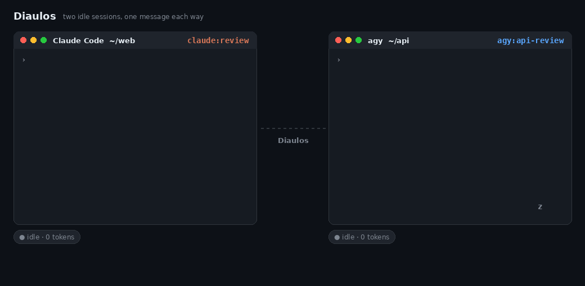
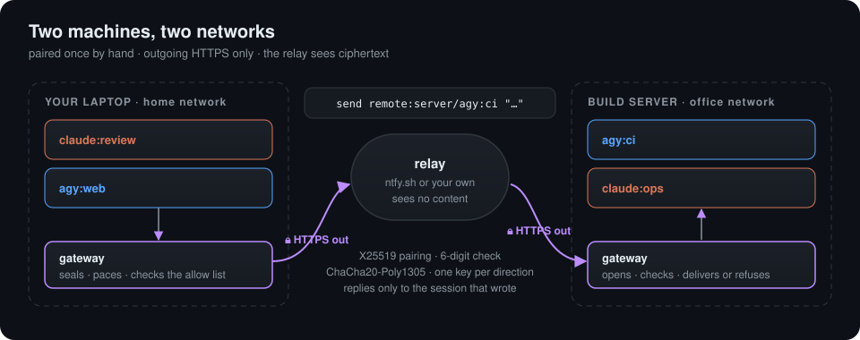
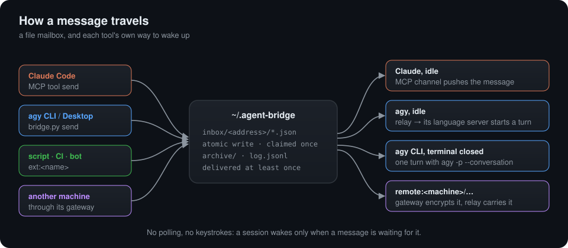

<div align="center">

# Diaulos

**Let your AI coding agents talk to each other — and wake each other up.**

Claude Code ⇄ Google Antigravity (agy) · on one machine or across networks · no polling, no fake keystrokes

[](https://github.com/Dr1mS/Diaulos/actions/workflows/tests.yml)    [](LICENSE)

[Quick start](#quick-start) · [Other machines](#other-machines) · [Security](#security) · [How it works](#how-it-works) · [Français](README.fr.md)



</div>

---

You run Claude Code in one terminal and Gemini in another. One writes the code, the other should review it, and **you** are the one copy-pasting between them, or waking up the one that went idle.

**Diaulos removes you from that loop.** Any session can send a message to any other one, and the message **wakes the receiver even when it is idle**, even when its terminal is closed, even when it runs on another machine. Each tool is woken through its own extension points: Claude Code through an MCP channel, agy through its own language server. Nothing polls, and nothing types into a terminal.

```text
you › ask the agy session in ~/api to review my last commit, and tell me what it finds

claude:review   → agy@api      "Review commit 3f2a1c7 and send me your findings."
                                 (agy was idle — the relay wakes it)
agy:api-review  → claude:review "2 issues: unchecked None in parse_config(), missing test for…"
                                 (Claude was idle — the MCP channel wakes it)
claude › agy found 2 issues. I fixed the None check; want me to add the missing test?
```

<sub>An illustration of a typical exchange. In a real test, four sessions passed one message around a circle with no human involved: 36 s for the full loop, almost all of it model thinking. The bridge delivers in 1 to 3 s.</sub>

> *In the ancient Greek games, the* diaulos *was the out-and-back race: run to the far end of the stadium, turn, and run back. Here it is the trip a message makes from one agent to another and back.*

## Why Diaulos

|  | **Diaulos** | MCP mailboxes | tmux orchestrators | Claude Code agent teams |
|---|---|---|---|---|
| Wakes an idle session | ✅ native (MCP channel, agy language server) | ❌ agents must check their inbox | ⚠️ by typing into the terminal | ✅ |
| Claude **and** Gemini | ✅ | ✅ | ⚠️ some | ❌ Claude only |
| Connects the sessions you already have open | ✅ | ✅ | ❌ it launches its own | ❌ it launches its own |
| Reaches a closed agy conversation | ✅ `agy -p` | ❌ | ❌ | — |
| Across machines, end-to-end encrypted | ✅ no port, no SSH, no account | ⚠️ HTTP transport, not E2EE | ❌ | ❌ |
| Windows | ✅ | ✅ | ❌ | ✅ |
| Dependencies | Python stdlib (+ `cryptography` across machines) | an MCP server and its database | tmux | built into Claude Code |

A session is woken **only when a message is waiting for it**, and messages that arrive together are delivered in a single turn. In the author's use, that means far fewer wake-ups — and tokens — than Claude Code agent teams on comparable work. The [state of the art](docs/ETAT-DE-L-ART.md) (French) compares Diaulos with 13 projects and protocols (A2A, ACP, mcp_agent_mail, agent-deck…) and proposes a protocol to measure it.

## Features

- **Cross-vendor messaging** — Claude Code ⇄ Claude Code, agy ⇄ agy, Claude ⇄ agy, any number of sessions, in any directory.
- **Wake-on-message** — idle Claude Code and agy sessions take their turn by themselves when a message arrives.
- **Closed terminals still answer** — a message to an agy CLI conversation whose terminal is closed runs one turn with `agy -p`.
- **Spawn new sessions** — `agy:new-cli` / `agy:new` start a new agy session with the message as its first prompt.
- **Other machines** — pair two computers once, then `send remote:laptop/claude:review "…"`. Outgoing HTTPS only, ChaCha20-Poly1305 end to end, through ntfy.sh or your own relay.
- **Programs as peers** — a script, a CI job or a bot joins as `ext:<name>` and reads the agent's replies.
- **Safe by default** — peer messages never count as user approval; pairing and access changes need a human at a terminal.
- **Zero dependencies** — Python 3.8+ standard library (`cryptography` only for other machines), Linux and Windows, one install script.
- **See it happen** — with [Paros](https://github.com/Dr1mS/Paros), each session is a pixel pet on your desktop and every message flies from one to the other as a letter.

<div align="center">


<sub>Diaulos messages, seen through <a href="https://github.com/Dr1mS/Paros">Paros</a>.</sub>

</div>

## What people use it for

- **Planner and workers.** A planner session hands tasks to worker sessions, each in its own repository, and collects their reports.
- **A second opinion.** One model reviews what the other wrote. In a real test, agy reviewed this project's own code and found three real bugs, all fixed since ([journal](docs/JOURNAL.md#4-relecture-croisée-autonome-14451449)).
- **Your laptop and a server.** Claude on your laptop asks an agy session on a build server to run the slow tests and report back.
- **Two developers, two machines.** Each person's agent talks to the other's, within the limits each owner allowed.
- **CI to agent.** A failing job sends its log to an agent and gets a diagnosis back.

## Contents

- [Installation](#installation) · [Quick start](#quick-start) · [Addresses and commands](#addresses-and-commands)
- [agy CLI and Antigravity Desktop](#agy-cli-and-antigravity-desktop) · [Other machines](#other-machines) · [Programs and scripts](#programs-and-scripts)
- [Security](#security) · [Troubleshooting](#troubleshooting) · [Status and limits](#status-and-limits)
- [How it works](#how-it-works) · [Development](#development)
- More: [Internals](docs/INTERNALS.md) · [Changelog](CHANGELOG.md) · [Lab notebook](docs/JOURNAL.md) (French) · [State of the art](docs/ETAT-DE-L-ART.md) (French)

## Installation

Requirements: Linux or Windows 10/11, Python 3.8 or later, the agy CLI or Antigravity Desktop, and Claude Code if you want Claude sessions to join.

```bash
git clone https://github.com/Dr1mS/Diaulos && cd Diaulos
./install.sh --shell                     # Linux
```

```powershell
powershell -ExecutionPolicy Bypass -File .\install.ps1 -Shell    # Windows, from PowerShell
```

On Linux with Antigravity Desktop, add `--auto-relay` (experimental: see [Antigravity Desktop](#antigravity-desktop)). To message other machines, also run `python3 -m pip install cryptography`.

Then:

1. **Restart your agy sessions.** agy loads hooks only at startup.
2. **Open a new terminal for Claude Code.** With `--shell` / `-Shell`, a plain `claude` starts with the bridge channel; Claude Code shows a confirmation screen for it at each launch.

**Updating:** `git pull`, then run the installer again with the same options, and restart your sessions. A session started before the update keeps the old code.

**Removing:** `./uninstall.sh` (`.\uninstall.ps1` on Windows); add `--purge` (`-Purge`) to also delete the mailboxes and the keys of paired machines.

## Quick start

You do not have to type commands: each agent knows its own address and how to reach the others. agy is told at startup by its hook; Claude Code gets the `send` and `list_agents` tools of the `agent-bridge` MCP server. Just ask:

- in Claude Code: *"send this diff to agy for a review"*;
- in agy: *"ask the Claude session to check the tests"*.

The same thing by hand, from a shell:

```bash
python3 ~/.agent-bridge/bridge.py list
#  agy:52620e0d-…  "api review"  /home/me/projects/api  relay pid 225225: wakes on message
#  agy:e9439252-…  "web"  /home/me/projects/web  agy CLI, no process: wakes with agy -p
#  claude:review  /home/me/projects/api  MCP channel: wakes on message

python3 ~/.agent-bridge/bridge.py send agy@web "Can you check the API change I just made?"
```

The receiver answers to the `from` address of the message it got.

> **Windows:** Windows PowerShell does not expand `~` in arguments to programs. Write `python3 $HOME\.agent-bridge\bridge.py …`. Agents need nothing special: they are given the absolute path.

## Addresses and commands

| Address | Who |
|---|---|
| `claude:<session name>` | A Claude Code session started with the channel. It follows `/rename`. |
| `claude` | The only other Claude session; when none is listed, the shared inbox read by `watch claude` |
| `agy:<conversationId>`, `agy:<id-prefix>` | One agy conversation (CLI or Desktop) |
| `agy:<title>` | An agy conversation by its title (`/rename`, or the one agy gives it); refused when two share it |
| `agy@<part-of-its-folder>` | The agy conversation whose folder contains that text |
| `agy` | The only other active agy session |
| `agy:new`, `agy:new@<title>` | A new Antigravity Desktop conversation, with the message as first prompt (Linux) |
| `agy:new-cli`, `agy:new-cli@<name>` | A new agy CLI conversation, with the message as first prompt |
| `ext:<name>` | A program connected with `watch ext:<name>` |
| `remote:<machine>/<address>` | A session on a paired machine, e.g. `remote:laptop/claude:review` |

`bridge.py` is `~/.agent-bridge/bridge.py`. The MCP tools of Claude Code take the same addresses and options.

| Command | What it does |
|---|---|
| `bridge.py list [--days N \| --all]` | Live sessions and how each one gets woken. agy conversations of the last 7 days, or N days, or any age |
| `bridge.py send <to> <text…>` | Send a message; `-` as text reads it from stdin |
| `… --workspace <dir>` | With `agy:new` / `agy:new-cli`: where the new session works (for `agy:new`, also a Desktop workspace name) |
| `… --from <address>` | Sender address, for a program or a script |
| `bridge.py watch <address> [--json]` | Print each new message for that address, forever |
| `bridge.py recv <address> [--json]` | Print and archive the waiting messages once |
| `bridge.py ensure-relay` | From an agy shell: start the relay that wakes this agy (agy is reminded to) |
| `bridge.py remote <command>` | Pair machines and run the gateway: see [Other machines](#other-machines) |

## agy CLI and Antigravity Desktop

| | agy CLI | Antigravity Desktop |
|---|---|---|
| Open, after its first message | reachable once agy has run `ensure-relay` (it is reminded to) | reachable once the window has a relay |
| Open, before any message | not reachable: the conversation does not exist yet | not reachable either; the window's other conversations are, with `--auto-relay` |
| Terminal or tab closed | reachable: each batch of messages runs one turn with `agy -p --conversation <id>` | reachable: delivery loads it from disk |
| Listed | conversations of the last 7 days (`--days N` / `--all` for older); any age by exact id or title | same |
| New session from another agent | `agy:new-cli`, `agy:new-cli@<name>` | `agy:new`, `agy:new@<title>` (Linux) |

### agy CLI

When an agy CLI conversation's terminal is closed, `list` shows it as `agy CLI, no process: wakes with agy -p`, and a message to it runs one turn in its directory, with your usual agy settings. If you open it again with `agy --conversation <id>`, its hooks and relay take over.

```bash
python3 ~/.agent-bridge/bridge.py send agy:new-cli@builder "Build the project and send the errors to claude:api" --workspace ~/projects/api
# after its first turn, the bridge sends you its address; it is also reachable as agy:builder
```

- These turns run with your agy permissions. With `toolPermission: always-proceed`, they run on their own; with a setting that asks before some tools, a turn that needs one waits 30 min and fails. Diaulos never passes `--dangerously-skip-permissions`.
- Use one of agy's trusted workspaces (`trustedWorkspaces` in `~/.gemini/antigravity-cli/settings.json`) as directory.
- Each turn starts a new `agy` process: about 10 s before the model starts thinking. Messages over 100,000 characters are refused.

### Antigravity Desktop

Desktop runs every conversation of a window in one language server, so one relay per window serves all its conversations: open or closed tabs, and the conversations of the last 7 days.

```bash
python3 ~/.agent-bridge/bridge.py send agy:new@tester "Run the test suite and send the failures to claude:api" --workspace ~/projects/api
```

`--workspace` takes a directory or the name of a Desktop workspace; Desktop files the conversation under that workspace.

**Auto-relay (Linux, experimental, off by default).** With `./install.sh --auto-relay`, a Desktop window needs no `ensure-relay`: as soon as an agent lists or messages agy sessions, Diaulos starts the window's relay itself, with the token it reads on the language server's command line. Without it, one `ensure-relay` per window start is enough, from any of its conversations. It is off by default because it reads a secret outside the path agy documents (no new access: the relay holds the same token, and any local process can read that command line), and because an Antigravity update can move it. Re-run `./install.sh` without the option to turn it off.

## Other machines

Sessions on **different machines** can talk too: on another network, even on another person's computer with other Claude or Google accounts. Both machines only make outgoing HTTPS requests to a relay (ntfy.sh by default, or your own), and the relay only ever sees ciphertext.

<p align="center"></p>

**1. Install `cryptography` on both machines** (`python3 -m pip install cryptography`).

**2. Pair the two machines, once, in a real terminal on each.** Agents can't do this, by design: these commands refuse to run without a terminal (in Claude Code, a `!` command does not count).

```bash
python3 ~/.agent-bridge/bridge.py remote invite laptop     # on machine A: prints a one-time code, valid 15 min
python3 ~/.agent-bridge/bridge.py remote join desktop      # on machine B: asks for the code, hidden
```

Pass the code over a channel you trust, never through an agent. Both terminals then show a 6-digit code: compare them and confirm on both sides. Each side then chooses which of its own sessions the other machine may write to first, for example `claude:*` or `claude:review` (empty: none). The gateway that carries the messages starts on both machines.

**3. Agents do the rest.** The `diaulos-remote` skill tells Claude how. A session on the other machine is `remote:<machine>/<address>`: `send remote:laptop/claude:review "..."`. A session that wrote first gets the replies; `list` shows the sessions the other machine says you can reach.

| Command | Who | What it does |
|---|---|---|
| `remote invite <name> [--relay URL]`, `remote join <name>` | you | pair two machines |
| `remote allow <name> <pattern>` | you | let `<name>` write first to your sessions that match `<pattern>` |
| `remote relay-server [--host H] [--port P] [--trusted-proxy ADDRESS]` | you | host your own relay instead of ntfy.sh |
| `remote status`, `remote start`, `remote stop` | anyone | the gateway |
| `remote deny <name> <pattern>`, `remote unpair <name>` | anyone | narrow access, forget a machine and its key |

**The gateway** does not survive a logout or a reboot. It starts again by itself when an agy session starts (Linux), when a Claude Code session with the channel starts, and on the first send. A machine that only answers, such as a server, should start it at login. On Linux:

```ini
# ~/.config/systemd/user/diaulos-gateway.service, then: systemctl --user enable --now diaulos-gateway
[Unit]
Description=Diaulos remote gateway
[Service]
ExecStart=/usr/bin/python3 %h/.agent-bridge/bridge.py remote gateway
Restart=on-failure
[Install]
WantedBy=default.target
```

On Windows, create a Task Scheduler task "At log on" that runs `python <your home>\.agent-bridge\bridge.py remote gateway`.

**Limits.** ntfy.sh accepts about 250 messages a day per IP address and keeps them 12 hours: a machine that stays off longer misses the older ones. A message takes one relay message per 2.9 KB, and holds at most 64 KiB. For heavier use, host a relay with `remote relay-server` behind an HTTPS reverse proxy: with nginx, set `proxy_buffering off` and `proxy_read_timeout` above 25 s, and start the relay with `--trusted-proxy 127.0.0.1`. For strong availability, restrict it to your machines' IP addresses.

How the pairing, the encryption and the access rules work is in [Security](#security) and in the [internals](docs/INTERNALS.md#other-machines).

## Programs and scripts

A script, a CI job or a bot joins as `ext:<name>`. It sends with `bridge.py send <agent> - --from ext:<name>` (the text on stdin) and reads the agent's replies with `bridge.py watch ext:<name> --json`, one JSON object per line. While it watches, it is listed and agents can answer it. **Read the warning in [Security](#security) first.**

## Security

Diaulos lets agents act on what they receive. Read this before connecting anything.

**On one machine**

- **No authentication between local processes.** Any process running as your user can write to `~/.agent-bridge/inbox/`. A message to an agy session makes it act with that conversation's permissions, for example `always-proceed`. Only use Diaulos on a machine you trust.
- **Peers are not the user.** Incoming messages are labelled as coming from a peer agent. Agents are told that such a message never counts as user approval, and that they must never do for a peer something their own permissions blocked.
- **Unverified sender.** On one machine, the `from` address is declared by the sender.
- **agy's token** (`ANTIGRAVITY_CSRF_TOKEN`) never touches disk or logs.

> [!WARNING]
> **Connecting a program (`ext:<name>`) hands outside text to an agent that can act on your machine.** Anyone who can write to that program's source (a chat, an issue, a log line) can write to your agent, including instructions crafted to hijack it (prompt injection). The "peer" label is a hint to the model, not a barrier.
>
> - Connect only sources you trust. Never connect a public or shared source to a session that runs with `always-proceed`, auto-approval, or access to secrets.
> - Give the adapter its own agent session, in a directory that holds nothing sensitive.
> - Assume that anything the agent knows can end up in its replies.
> - Watch what the agent does, and stop the adapter when you are not around.

**Between machines**

- **Pairing is for people.** `invite`, `join`, `allow` and `relay-server` need a terminal, which agents don't have, so a prompt-injected agent cannot pair or open access. It is a speed bump, not a wall: a program already running as your user can edit `~/.agent-bridge/remote/` or fake a terminal.
- **Pairing protocol.** The invite holds a one-time 256-bit secret that authenticates an X25519 key exchange; both people compare a 6-digit code derived from the result. If someone copied the code and pairs in your place, the other person sees no code or a different one: answer no, and nothing is saved.
- **Encryption.** One root key per pair, one key and one relay topic per direction, every frame sealed with ChaCha20-Poly1305, padded to a multiple of 256 bytes. Changed, replayed or foreign frames are dropped. The relay sees topic names, sizes and times, never content.
- **Who may reach what.** A machine writes first only to the sessions in its allow list; wildcards never match `agy:new` and `agy:new-cli`. A session that wrote to a machine gets its replies for 24 hours, at that exact address. No hop to a third machine, at most 20 messages a minute per machine, and refusals return a fixed notice that reveals nothing about your sessions.
- **The machine is authenticated.** The gateway writes `from` as `remote:<machine>/<address>`, where `<machine>` is the name you chose, proven by its key. The address after the `/` is declared by the other machine.
- **Local senders still aren't.** Any local process can write to a machine in the name of a live local session, and so let the other machine reply to it. Pairing protects you from the other machine, not from your own agents.
- **Allowing `agy:new-cli` or `agy:new` amounts to giving the other machine a shell** with agy's permissions. Allow them only for a machine you trust like yourself.
- **A remote agent may be another person's agent.** Everything in the warning above applies. Allow only sessions that need it, never one with `always-proceed` or access to secrets. Agents are told never to send secrets to another machine, but that is a rule for the model, not a barrier.
- **Keys** live in `~/.agent-bridge/remote/peers/`, readable by your user only (on Windows, keep `AGENT_BRIDGE_HOME` inside your profile folder). `remote unpair` deletes them.

## Troubleshooting

| Symptom | Check |
|---|---|
| No channel confirmation screen when `claude` starts | Open a new terminal after installing, and check that you used `--shell` / `-Shell`. |
| agy never receives messages | Restart agy after installing. `~/.agent-bridge/state/last_<event>_input.json` is rewritten each time a hook runs. |
| `list` shows an agy session with `no relay` | Ask agy to run `bridge.py ensure-relay`, and read `~/.agent-bridge/state/relay-<conversationId>.log` (`auto-relay.log` with `--auto-relay`). |
| A message to an agy CLI conversation with `no process` gets no answer | Read `~/.agent-bridge/state/cli-<conversationId>.log` (`cli-new.log` for `agy:new-cli`). |
| `agy:new: no Antigravity Desktop window with a running relay` | Open Desktop, then list the agy sessions (with `--auto-relay`) or run `ensure-relay` in one of its conversations. |
| A Claude session is not listed | Only sessions started with the channel are listed. |
| `'agy' matches 2 live agy peers` | Pick one with `agy@<directory>`, `agy:<id-prefix>` or `agy:<name>`. |
| `'claude:<name>' matches 0 live claude peers` | That session ended, was renamed, or has no channel. Run `bridge.py list`. |
| `bridge.py remote …` prints the general usage | The installed copy is older: run the installer again. |
| `needs a person at a terminal` | Run the command yourself in a real terminal (not through an agent, not with `!` in Claude Code). |
| A remote message comes back `not delivered` | On the other machine, `remote status` shows who may write first; `remote allow <machine> <pattern>` widens it. Its `state/remote-gateway.log` says why. |
| Claude's `send` tool refuses `remote:` addresses | The session started before the update: restart `claude`. |
| Remote messages stop arriving | `bridge.py remote status`: start the gateway if it is stopped, and read `~/.agent-bridge/state/remote-gateway.log`. |

## Status and limits

- **Experimental.** Diaulos relies on undocumented methods of agy's language server (`SendUserCascadeMessage`, `StartCascade`, …), on the files agy writes, and on Claude Code channels, which are a research preview. Any of them may change without notice.
- An agy CLI session cannot be reached before its first message, and the relay costs agy one tool call in that first turn (`ensure-relay`, after the hook's reminder).
- `agy:new`, the auto-relay and Desktop conversations read from disk need Antigravity Desktop on Linux.
- Claude Code shows a confirmation screen at every launch while the channels preview requires it.
- On Windows, Claude Code's permission rules do not cover PowerShell commands run by Claude: it may ask before running bridge commands.

**Tested with**

- Linux, Claude Code 2.1.301, agy 1.4.9 (language server 1.4.0, Gemini 3.8 Flash): messaging and waking idle sessions with the agy CLI, Antigravity Desktop and Antigravity IDE; on Desktop, the shared relay, the auto-relay, a conversation not loaded since launch and `agy:new`; with the agy CLI, a closed terminal and `agy:new-cli`. Not verified yet: the newer Desktop features on the IDE, and the listening `Stop` hook on Desktop and IDE.
- Windows 11, Claude Code 2.1.296, agy (language server 1.4.0), Python 3.14: hooks, relay waking an idle agy, MCP channel waking an interactive Claude session, and messages both ways.
- Other machines (2026-11-06): a Linux machine and a second computer on another network, paired through ntfy.sh, a Claude Code session on each side: a refusal and its notice, then a message and its reply. Not verified yet: the gateway on a real Windows machine (the test suite passes on Windows in CI).

## How it works

Claude Code and agy share no protocol, so Diaulos uses a file mailbox in `~/.agent-bridge/` plus the extension points each tool offers. While agy is working, a hook injects the message before its next model call; when it is idle, one of these paths wakes it:

<p align="center"></p>

A message is claimed atomically, so two readers never get the same one, and it leaves the inbox only once handed over: delivery is at least once. Every detail, including what the installer changes on your machine, is in [docs/INTERNALS.md](docs/INTERNALS.md).

**What gets installed:** `~/.agent-bridge/` (the bridge and its data), global agy hooks in `~/.gemini/config/hooks.json`, the `agent-bridge` MCP server for Claude Code (user scope), the `agy-bridge` and `diaulos-remote` skills in `~/.claude/skills/`, allow rules in `~/.claude/settings.json`, and with `--shell` / `-Shell` the `claude` wrapper (`~/.bashrc`, PowerShell profile, cmd `AutoRun`). Each config file is backed up first as `<file>.bak-agent-bridge`, and the uninstaller reverts everything.

## Development

The tests use only the standard library (plus `cryptography` for the remote tests, skipped without it). They run against stand-ins (a fake Antigravity language server, a fake `agy`, a local relay and two bridge homes as two machines) in temporary folders, so they never touch your real sessions:

```bash
python3 -m unittest discover -s tests -v
```

The Desktop and agy CLI tests run on Linux only. GitHub Actions runs the suite on Linux (Python 3.8 and 3.12) and Windows at every push and pull request. The [lab notebook](docs/JOURNAL.md) (French) records every experiment and design decision.

## License

Apache License 2.0 — see [LICENSE](LICENSE). Copyright 2026 Adrien.M (Dr1mS).
